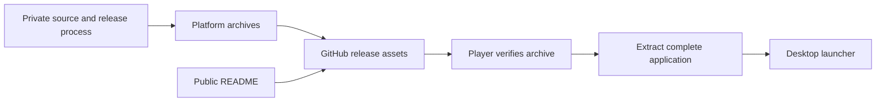
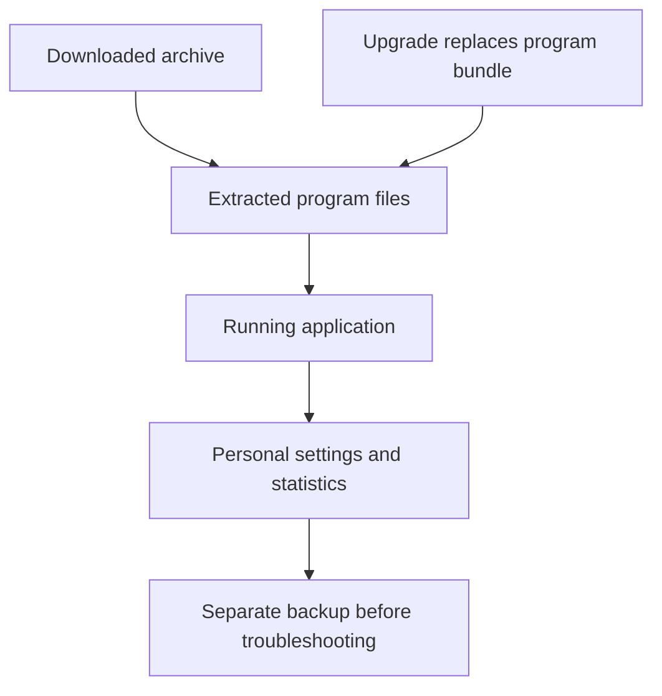

# Distribution architecture and data ownership

Only the README and documentation are inspectable implementation in this repository. The source/build process is an external boundary, not a runnable subdirectory here. A player needs the release archive, not a clone of this repository. Conversely, a source maintainer needs the source project; downloading the program is not a substitute for editable source.

## Package layout is a contract

The Linux command expects a `ClassicArcade` directory containing an executable named `ClassicArcade`. Windows expects the extracted executable and its neighboring files to stay together. macOS expects the application bundle to remain intact. Moving only a launcher out of a bundled application can break dynamic-library, Python-runtime or resource lookup. The README specifically tells Windows users to keep the program folder together; apply the same conservative approach to all packaged platforms unless a release explicitly says otherwise.

A checksum is a digest of exact archive bytes. It detects accidental corruption and mismatch against a published companion file. It does not independently establish publisher identity if both files came from an untrusted source. Download from the repository's actual release page and record the version. Do not edit an archive and then continue describing its original checksum as valid.

## Installed files versus personal data

The README explicitly locates macOS settings and statistics at `~/Library/Application Support/OchsSoftClassicArcade`, outside the application bundle. Replacing the app should therefore preserve that directory. The exact filenames and schemas are not documented in this checkout. The Windows and Linux personal-data locations are not specified in the root README; do not assume they are inside the installation directory or use a guessed cleanup command.

The application-to-data arrow describes documented macOS separation and a general preservation boundary; it does not invent unverified paths on other platforms. There is no database service, port or container defined here. A program closing is not a remote deployment shutdown.

## What a support report should contain

Record OS and architecture, actual release tag, archive filename and digest, launch command, and the shortest reproducible symptom. Include readable terminal errors where available, removing account paths or personal content before publishing. Do not attach an entire personal-data directory merely because settings may be involved. Preserve originals privately for later investigation.
