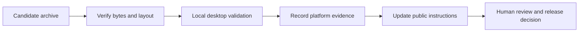

# Maintaining releases and documentation

## Keeping the handbook useful
When code changes, update the chapter that explains its contract, the relevant diagram, the change recipe, and this pinned source register. Keep the Word and PDF editions synchronized with the Markdown chapters. Record what was actually tested, what remained unverified, and which saved data must survive an upgrade. A future maintainer should be able to trace an instruction to a file or a test without relying on a previous conversation.

## Recipe: publish clearer installation instructions

Read the current README and inspect an actual candidate release's asset names through the release owner's approved workflow. Make a table of documented package, checksum companion, extraction result and launcher. Correct only claims supported by that package. Keep `latest` links for convenience while retaining a named version and actual local verification in the PR evidence.

Test every relative handbook link locally and run `git diff --check`. A local source diff can verify spelling and destinations; it cannot verify a remote asset exists or a game launches. If remote links are being checked, actually inspect them rather than treating a Markdown parser's acceptance as network evidence. No remote release inspection was performed for this edition.

## Recipe: improve a NixOS failure report

Begin with an unchanged verified archive, record the wrapper command and collect the terminal error. Confirm that the executable remains in its complete extracted directory. Ask whether the failure occurs before a window appears, while opening graphics/audio, or during normal play. Reproduce under the source project's maintained environment before changing packaging. If a missing library is suspected, fix the release contract or documented environment deliberately; do not tell every player to copy random libraries beside the executable.

This is a maintenance lifecycle, not an existing automated workflow. This repository does not provide a release script. Routine hosted CI remains disabled under workspace policy; release/deployment actions require their own authorized human gate.

## Recipe: document personal data safely

Obtain the actual platform path, filenames, save trigger and schema/version behavior from the source implementation and local tests. Add a public guide that explains backup and restore using disposable test data. Prove that replacing the application preserves statistics, that a restored copy is read correctly, and that malformed data produces a useful error or safe fallback. Never publish a real player's complete files as a test fixture.

An executable bug fix belongs in the source repository. The public repo can track the symptom and corrected release version without disclosing private code. Keep owner-only implementation details out of public documentation; a public support procedure should describe observable behavior and supported remedies.
