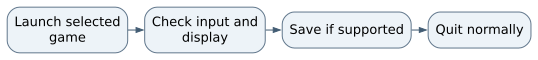

# Classic Arcade downloads Operations Guide

This repository hosts release downloads and installation information. It is not the game source repository. Use the release package for play rather than trying to build an application from this folder.

## Start the game on NixOS

Open this repository's Releases page and choose the intended Linux x86_64 package and its checksum. Verify the checksum with the supplied filename, extract the whole archive, and keep the program and its _internal directory together. The source installation guide provides this NixOS compatibility path when steam-run is already available:

```bash
steam-run ./ClassicArcade/ClassicArcade
```

The generic archive includes Python and the game dependencies. It still needs a real graphical desktop, graphics/audio drivers, and an appropriate compatibility environment. A native NixOS source package is a separate maintainer path, not an artifact contained here.

## Check and troubleshoot

Open a game, test input and display, and verify audio at a safe volume. A missing dynamic loader on NixOS is different from a missing game file. Retain the complete extracted folder and the original error; do not clear settings to repair a dependency. The Linux package does not establish ARM or musl support, and platform checks do not replace controller/audio QA.

## Close and preserve progress

Use the normal Quit action or close the game window and wait for it to exit. Settings and statistics are stored outside the application folder; preserve that data during upgrades. Removing configuration is deliberate data deletion, not normal uninstall or shutdown. No database, AI model service, or web server needs stopping for this download repository.

## Maintain these instructions

Keep download names, checksums, platform claims, and release notes tied to actual published artifacts. Validate install, play, graceful quit, and reopened settings on the intended platform before claiming support. Publishing a new release requires its own human release process.

## Before you begin

Choose the exact application or game instance, source version, and working copy. Development and installed releases can use different save locations. Preserve original documents, media, and game saves before an update. Stop through the normal save and quit controls; interrupt only a remaining foreground process you personally started.

## Keep troubleshooting scoped

Record the first error, source revision, working directory, and selected instance. Check the stated prerequisites before changing anything. Preserve useful work before resets. Stop only the process or dedicated dependency you own; do not kill by a guessed port or broad name. Keep credentials and private records out of reports. Migrations, seeds, volume deletion, deployment, and new model downloads are separate operations, not generic restart fixes.

## Normal operating sequence



## Maintaining this guide

Keep this Markdown, the editable Word edition, PDF, and operating-flow.svg together here. Update them when merged commands, storage, dependencies, or limits change. Edit Word and export PDF independently when convenient, then inspect the affected pages. No running AIOS service is needed to read or maintain these documents.

Source-defined instructions and known gaps are distinguished above. This documentation task did not launch the application or prove a new production workflow. Verify changes locally on NixOS; use a topic PR and human merge for owned source. Deployment is separate, and routine hosted CI remains disabled.

## Source and edition

Edition 26 October 2026. Repository OchsSoft/classic-arcade. Inspected source revision `5b053cbe624052ea00becae94e34d5eeb43e948e`.

Source files: [README.md](https://github.com/OchsSoft/classic-arcade/blob/5b053cbe624052ea00becae94e34d5eeb43e948e/README.md).

[Editable Word edition](Operations_Guide.docx) | [PDF edition](Operations_Guide.pdf)
